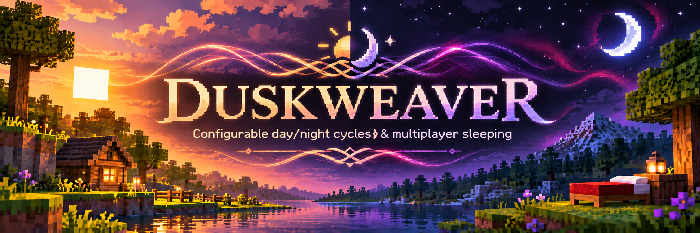

# Duskweaver

**Weave time to your will.** A configurable day/night, multiplayer sleeping, weather, and optional Nightmare encounter plugin for Minecraft Paper.

Duskweaver is designed for hard-survival servers that want predictable day/night timing and useful sleep controls without changing the core survival experience.

## Features

### Day/night and sleep
- Configure daytime and nighttime independently (defaults: **15 minutes day / 5 minutes night** at 20 TPS).
- Select managed worlds.
- Choose single-player sleep, majority voting, or vanilla quorum behaviour, with a configurable countdown.
- Exclude spectators and optionally inactive players from sleep calculations.
- Optionally clear stormy weather after a successful night skip.
- Support sleeping through daytime thunderstorms without advancing the clock to morning.

### Nightmares
Optional, Beta-inspired unsafe-bed encounters:
- Detect dark, spawnable locations connected to a bed by **bounded ground-level pathfinding**. Open doors and indirect routes may make a bed unsafe; blocked approaches should not.
- Apply a configurable chance **only after** finding a qualifying unsafe approach (default: **5%**).
- Run a **three-tier encounter** with configurable monster pools, equipment, health, rewards, and Tier 3 names/titles.
- Prioritize collision-free monster positions near the player, including illuminated interiors when there is sufficient room.
- Display a configurable **Gold / Light Purple** countdown title with a native **PINK** progress BossBar across all three tiers, alongside the Tier 3 health BossBar.
- Award tier-specific weighted rewards directly to inventory, dropping only overflow near the player.
- Support configurable reward multipliers for Normal and Hard difficulty; Nightmares are disabled on Easy and Peaceful.
- Hold the night before dawn while a Nightmare is pending or active; clean up interrupted encounters and tagged entities.
- Start and persist a per-player cooldown when the first Nightmare monster spawns, including after disconnects, deaths, timeouts, cancellations, and server restarts.

The default encounter timeout is **300 seconds**, and the default cooldown is **240 minutes**. A cancelled encounter does not award unfinished tier rewards.

## Requirements

- **Server:** Paper 26.3 (API `26.3.build.244-stable`)
- **Java:** 25
- **Build:** Maven
- **Folia:** Not supported

## Installation

1. Build with `mvn clean package`, or obtain the compatible JAR.
2. Stop the server and place **one** Duskweaver JAR in `plugins/`.
3. Start the server and review `plugins/Duskweaver/config.yml`.
4. Merge new settings into an existing configuration manually; plugin upgrades do not automatically replace it.
5. Use `/duskweaver reload` or `/dw reload` for supported configuration changes.

## Configuration

The complete, commented configuration is in [`src/main/resources/config.yml`](src/main/resources/config.yml).

```yaml
day-length-minutes: 15.0
night-length-minutes: 5.0

worlds:
  - world

nightmares:
  enabled: true
  spawn-chance-percent: 5.0
  cooldown-minutes: 240
  encounter-timeout-seconds: 300
  debug: false
  countdown-bossbar:
    enabled: true
  search-radius: 24
  vertical-search-range: 16
  pathfinding:
    random-attempts: 20
    max-visited-nodes: 3000
```

This is an abbreviated example, not a replacement for the full generated YAML. The actual config also contains sleep controls, tier settings, names, rewards, and visual effects. Set `nightmares.debug: true` temporarily when testing unsafe-bed detection.

### Nightmare timing and cooldown

The countdown BossBar displays remaining time from the **encounter start**, using `nightmares.encounter-timeout-seconds`. It does not reset between tiers. Its title uses Minecraft Gold (`§6`) and Light Purple (`§d`) formatting, and the bar uses Minecraft's native `PINK` BossBar colour. Tier 3 retains its separate Dark Purple presentation.

Cooldown is associated with the player's UUID and recorded in `plugins/Duskweaver/nightmare-progress.yml` once Tier 1 spawns. Disconnecting or interrupting the fight does not make another Nightmare immediately available. A failed eligibility check or probability roll does not consume the cooldown.

### Pathfinding and spawning

The unsafe-bed check uses a bounded Paper-API traversal, **not** Minecraft's native AI pathfinding. Darkness is checked for eligibility; once the event starts, monsters can spawn in sufficiently clear, illuminated locations near the player. The detector and encounter placement are separate systems.

## Commands and permissions

| Command | Permission | Purpose |
| --- | --- | --- |
| `/duskweaver reload` | `duskweaver.reload` | Reload supported configuration |
| `/dw reload` | `duskweaver.reload` | Alias |

The reload permission defaults to operators.

## Operational notes

- The configured durations assume 20 TPS; lag affects real-world timing.
- Avoid other plugins simultaneously controlling the same world's clock or sleep gamerules.
- Encounter interruption cleans up mobs and UI rather than resuming an unfinished fight on reconnection.
- On unexpected shutdown, tagged orphan entities are cleaned when relevant chunks load.
- Keep backups of `config.yml` and `nightmare-progress.yml` when upgrading.
- Test configuration changes on a staging server before deployment.

## Project information

- **Author:** iruixos
- **Platform:** Paper
- **Java package:** `com.iruixos.duskweaver`
- **Development:** Includes AI-assisted code, tested by a human on a Paper server. :)

## License

Duskweaver is licensed under the MIT License. See [LICENSE](LICENSE) for details.
